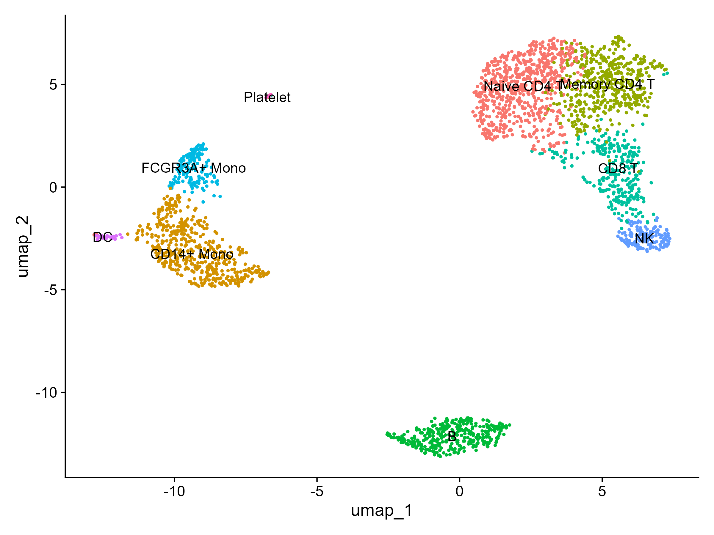

# Single-Cell RNA-seq Analysis of PBMCs using Seurat

## Project Overview
This project demonstrates an end-to-end Single-Cell RNA Sequencing (scRNA-seq) bioinformatic workflow using R and the `Seurat` library. The primary objective is to analyze a dataset of ~2,700 Peripheral Blood Mononuclear Cells (PBMCs) from a healthy donor, perform quality control filtering, normalize gene expression, identify key cell clusters, and annotate major immune cell populations.

---

## Workflow Steps

1. **Data Acquisition & Preprocessing**:
   - Loaded raw scRNA-seq expression matrices (10x Genomics dataset via `Seurat`).
   - Initial dataset comprised **13,714 features (genes)** across **2,700 single cells**.

2. **Quality Control (QC) & Filtering**:
   - Calculated mitochondrial gene expression percentage (`percent.mt`).
   - Filtered out low-quality/dying cells and doublets using standard thresholds:
   - 200 < nFeature_RNA < 2500
   - percent.mt < 5%
   - Retained **2,638 high-quality single cells** for downstream analysis.

3. **Data Normalization & Feature Selection**:
   - Applied global-scaling normalization (`LogNormalize` method with scale factor of 10,000).
   - Identified the top 2,000 highly variable features using the `vst` selection method.

4. **Dimensionality Reduction & Clustering**:
   - Scaled the data to shift gene expression baseline mean to 0 and variance to 1.
   - Performed Principal Component Analysis (PCA) on top variable features.
   - Built a K-Nearest Neighbor (KNN) graph and identified cell clusters using the Louvain algorithm (`resolution = 0.5`).
   - Visualized cell clusters via Uniform Manifold Approximation and Projection (**UMAP**).

5. **Cell Type Annotation**:
   - Annotated clusters into 9 distinct cell types based on canonical marker expression:
     - Naive CD4 T Cells
     - Memory CD4 T Cells
     - CD14+ Monocytes
     - FCGR3A+ Monocytes
     - B Cells
     - CD8 T Cells
     - Natural Killer (NK) Cells
     - Dendritic Cells (DC)
     - Platelets

---

## Results & Visualization

---

## Environment & Tools
- **Language**: R
- **Environment**: RStudio / Windows 10
- **Key Packages**: `Seurat`, `ggplot2`, `dplyr`
